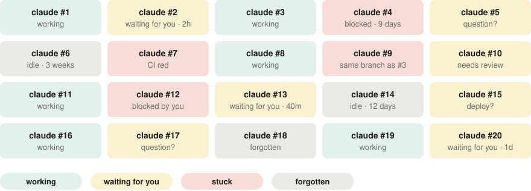
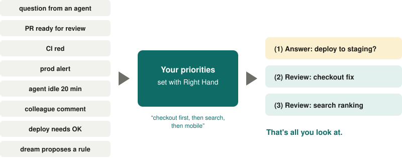
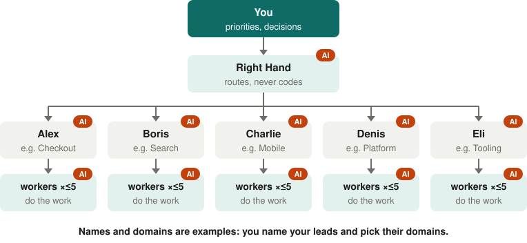
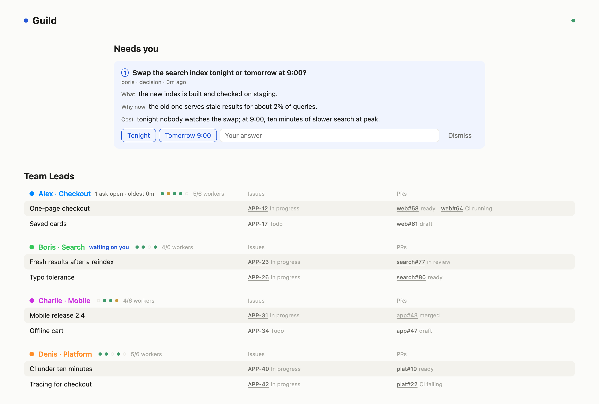
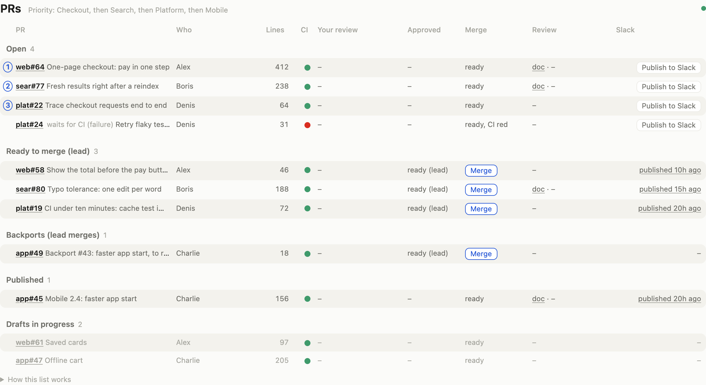
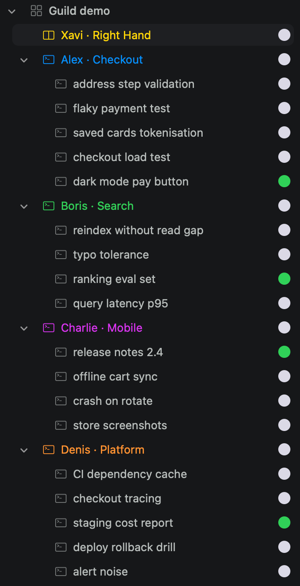
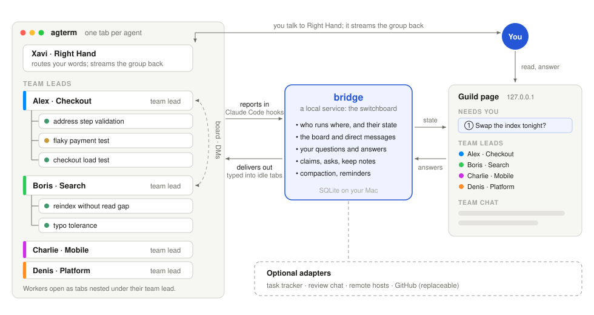
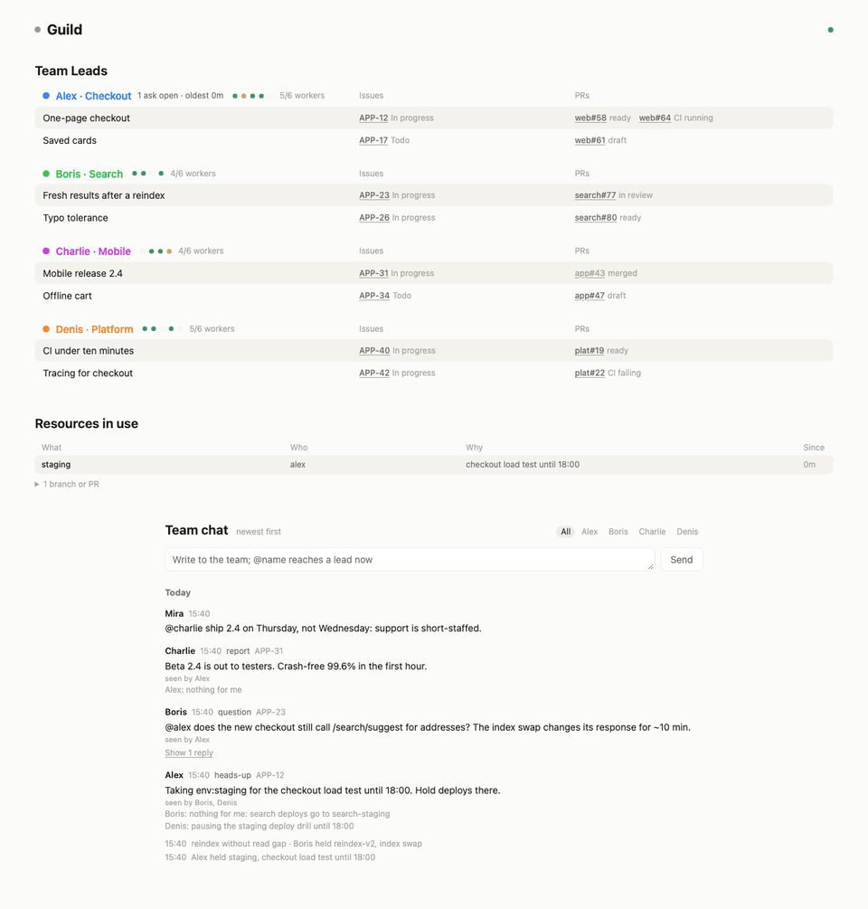
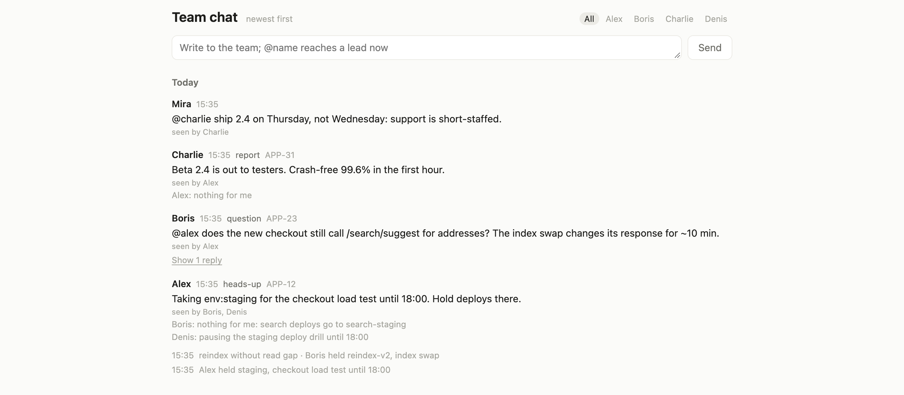

<p align="center">
  
</p>

<h1 align="center">Guild</h1>

<p align="center"><b>One eye, twenty agents.</b><br>
Your attention is the Eye of Sauron. Guild tells it where to look.</p>

## Still doing this? 😏

One agent. One human. One phone.

```text
$ claude
> refactor the billing module
✻ Thinking… (4m 12s)
? Should I also update the tests? (y/n)
  ▌ waiting for you since 11 min
```

The agent waits 11 minutes for you. You scroll your feed for 11 minutes. Both very expensive, both mostly idle.

## Then you opened twenty terminals

Agents got strong. Each one finishes a real task alone now, so you run fifteen, twenty of them. Your job is no longer
the work. Your job is deciding where to look.



Congrats: you are the bottleneck.

## The Eye

Your attention is the Eye of Sauron: it sees everything, but only where it looks, and it looks one way at a time.
One beam. Twenty agents. Everything off the beam:

- ⏳ **waits**: an agent idles on your answer; a question sits for days;
- 🌀 **drifts**: agents finish and nobody reviews; priorities get guessed, not set;
- 💥 **collides**: two agents, one branch; two fixes, one bug;
- 🙈 and **you find out last**: "What is this?" "Why do I see this?" "Why is it red?" **"WTF?!"**

## The idea

Guild has one job: tell the Eye where to look next.

Everything that needs you lands in one feed: a question from an agent, a PR ready for review, red CI, an alert, an
idle agent, a colleague's comment, a deploy waiting for your OK. Guild ranks it by the priorities you set. You look at
the top three. That's it.



## The org

To feed that list, Guild runs a tiny company in your terminal. Everyone in it is an AI, except you.



- **You** set the priorities and make the calls only you can make.
- **Right Hand** is the one agent you talk to. It routes your words and brings you one question at a time. It never
  writes code.
- **Team leads** each own a domain. They brief workers, route and verify. Managers never implement.
- **Workers** do the actual work: up to five per lead, one task each.

## Build your own harness

I believe the right harness is the one you build for yourself. Someone else's never quite fits, and that includes
mine. So be bold: write your own, and steal these ideas. They're battle-tested.

1. 👁 **One feed for you.** Every event that needs your attention, ranked.
2. 💎 **Shaped for your attention.** Most signal per glance: pages, not walls of text.
3. 📋 **One priority list.** Shared by all agents; you change it as you go.
4. 🌳 **A tree of agents.** Managers don't code: they brief, route, verify.
5. 🎯 **Specialised leads.** Each owns a domain; domains shift over time.
6. 🔍 **Evidence on every claim.** Observed, reproduced or from code; spot-checked.
7. 🤝 **Agents talk and claim.** Leads message each other and claim what they touch.

Or take mine whole. It's below.

## What it looks like

**One page. Every lead, every worker, and whatever needs you on top.**

<picture>
  <source media="(prefers-color-scheme: dark)" srcset="docs/images/guild-dark.png">
  
</picture>

**Every PR in flight on one screen. Numbers tell you where to look first.**

<picture>
  <source media="(prefers-color-scheme: dark)" srcset="docs/images/guild-prs-dark.png">
  
</picture>

<sub>Demo data.</sub>

## How you work with it

Starting agents is easy. Staying in charge of them while you switch context all day is the hard part.

So Guild gives you a crew: team leads who own projects, workers under them, you on top, and one page that shows what
needs you.

You choose how hands-on you are, per project and per decision. Full vibe coding, where leads plan, build, test and
merge on their own. Or rules, checkpoints and review points where they stop and wait for you. Go deep on one project
when it needs you; let the rest run. And Right Hand never makes you wait: questions for you queue up on the page while
you keep talking.

**You type no commands.** You talk to Right Hand and your team leads in plain words, and they run everything. The
commands in this README only show how it works.

## In 30 seconds

<table>
<tr>
<td width="26%" valign="top"></td>
<td valign="top"></td>
</tr>
<tr>
<td valign="top"><sub>The crew in agterm: Right Hand, four team leads, their workers.</sub></td>
<td valign="top"><sub>How it fits together: bridge in the middle carries every report, message and answer.</sub></td>
</tr>
</table>

- **Team leads.** A team lead is what Claude Code was before Guild: one window doing the work. Except now it doesn't
  stop for you at every step. It takes tasks, splits them across workers, tests, verifies, merges, and asks you only
  what it can't decide. Each one owns a project and lives in its own named, tinted agterm tab.
- **Workers.** A team lead opens a worker tab for each separate task, nested under its own, and checks the result.
- **Right Hand.** The one tab you talk to. It routes your words to the right team lead and streams back what's
  happening in every team: decisions made, work finished, problems found.
- **bridge** is the switchboard underneath, a small local service. Every agent reports its state to it through Claude
  Code hooks; every message, answer and reminder goes out through it, typed into the right agterm tab; it serves the
  page. Agents talk to each other through it, on a board and in direct messages. You relay nothing.
- **Compaction with keep notes.** When an agent's context fills up, it saves what must survive, bridge compacts it and
  hands the notes back. A team lead keeps going for days.
- **Everything else is optional**: a task tracker, a review chat, remote hosts, the GitHub PR queue.

<details>
<summary><b>See it move</b>: a question arrives, you answer it, the team lead reports back (12 s)</summary>


</details>

## Get started

1. Install [agterm](https://github.com/umputun/agterm).
2. Open a tab in it and start Claude Code (`claude`).
3. Paste this:

   ```text
   Set up Guild for me from https://github.com/Yuvasee/guild: install it, then start my Right Hand and a first team lead.
   ```

Claude Code follows [SETUP.md](SETUP.md): it checks what you have, installs Guild, starts the dashboard, and opens
Right Hand and your first team lead in their own tabs. It asks only what it can't know: your name and what the first
team lead should own. From then on, talk to Right Hand.

Reviewing in VS Code? Install the small local extension in [vscode/guild-review-pr-tree](vscode/guild-review-pr-tree):
a PR opened from the page then shows its own changed-files tree straight away.

## Concepts

<details>
<summary><b>Team leads</b>: one autonomous owner per project</summary>

**Why:** you can't hold five projects in your head, and you shouldn't have to restart each one every morning. A team
lead holds one project for you, for days, and brings you only what needs you.

**How:** a team lead is a Claude Code session with a name, a scope and notes that outlive its conversations. Each new
session in its tab starts with the constitution, its role, its notes and the crew's state. It declares its main chunks
of work with their issues and PRs, and the page shows exactly those. It coordinates more than it types: separate tasks
go to workers.
</details>

<details>
<summary><b>Workers</b>: one tab per task, under its team lead</summary>

**Why:** one session doing five things loses track of all five. A worker does one thing in its own context, in
parallel, and the team lead stays free to coordinate and check.

**How:** a team lead opens a worker in a new agterm tab nested under its own, with a brief, and confirms it really
started. Workers report back over bridge. A team lead runs at most five and closes them when their job is done,
keeping the line that resumes each.
</details>

<details>
<summary><b>Right Hand</b>: your one conversation, both ways</summary>

**Why:** talking to every team lead yourself is exactly the context switching Guild exists to kill.

**How:** you talk to Right Hand in its tab. It passes your words to the right team lead, relays your answers, brings
you one question at a time with a recommendation, and keeps the project priority that orders the page. It also
streams the crew back to you: what each team decided, finished or got stuck on, and what it checked itself versus
what it took on a team lead's word.

A pending question never blocks your chat with Right Hand: questions wait on the page under **Needs you**, and when
you answer one in chat instead, Right Hand relays it and the question closes.
</details>

<details>
<summary><b>The constitution</b>: the few rules that come before every other</summary>

**Why:** roles, notes and house rules change all the time. A handful of rules shouldn't, and they come first
whenever anything else in Guild's prompts conflicts with them.

**How:** five short articles: honesty, the best outcome for the company and its customers, good faith, signal hygiene,
simplicity. Every team lead, Right Hand and every worker loads the full text at start and again after each compaction,
ahead of its role or brief. It lives in [src/bridge/constitution.md](src/bridge/constitution.md); edit it to make it
yours.
</details>

<details>
<summary><b>The board and direct messages</b>: agents talk to each other (core, always on)</summary>

**Why:** most questions one team has, another team can answer. If every one of them goes through you, you're the
bottleneck again.

**How:** the board is a shared channel for heads-ups, questions, reports and handoffs; direct messages go to one agent.
A message is typed into the recipient's tab once it is idle, or reaches it at its next tool call. Every team lead sees
board posts from other team leads and from you; only an `@name` wakes an idle one. Team leads acknowledge a post in one
line, shown faint and delivered to nobody. A thread pauses after four agent hops until you post in it. You read and
write all of it on the page as **Team chat**.


</details>

<details>
<summary><b>Needs you</b>: the only queue you must read</summary>

**Why:** your attention is the scarcest thing in the crew. It goes to decisions only you can make, in the order that
matters, and a pending decision never stops your conversation: you keep talking while questions queue up.

**How:** when a team lead can't go on without you, it posts a question with what, why now and what each answer costs,
plus answer buttons. The page shows these under **Needs you**. Click an answer, or answer Right Hand in chat and it
relays your words; either way the answer is typed straight into the asking tab and the question closes. The page
numbers the top three across questions and PRs: urgent questions, other questions oldest first, then PRs by project
priority. An urgent question also raises a macOS notification.
</details>

<details>
<summary><b>Focus</b>: one line per agent on what it's doing now</summary>

**Why:** a glance should tell you what every agent is on, without reading its tab.

**How:** each agent keeps a one-line focus; the page and the other agents read it, and bridge nags an agent whose
focus is missing or stale.
</details>

<details>
<summary><b>Claims</b>: no two agents on the same branch or environment</summary>

**Why:** parallel agents collide: two pushes to one branch, a deploy in the middle of someone's load test.

**How:** before touching a PR, branch, environment, path or issue another agent may use, an agent claims it; a second
claimant is refused and told who holds it. A hook also refuses `git push`, PR merges and configured deploy commands
aimed at something another live agent holds. The page lists claims under **Resources in use**.
</details>

<details>
<summary><b>Asks</b>: what you asked for, until you can see it done</summary>

**Why:** "done" from an agent often means "I changed something". You want to know it works where you will look.

**How:** every request you give goes into a ledger in your own words and stays there until someone other than the
agent that did the work has checked what you would see, and recorded where and how. Stale asks and unchecked claims
nag their owner; an ask quiet for 3 days is checked daily (still current, done or obsolete), and a verified one closes
by itself a day later unless you reopen it.
</details>

<details>
<summary><b>Compaction and keep notes</b>: long-running agents that don't forget</summary>

**Why:** a team lead that loses its decisions at every compaction can't own a project for days.

**How:** with `compact_at_tokens` set, an agent near that context size is told to save what must survive: decisions,
exact ids, open promises, the next step. bridge then types `/compact` into its tab and, after compaction, gives the
notes back with an instruction to continue. Team leads and Right Hand also get the constitution, their role, notes and
last dream back; workers get the constitution.
</details>

<details>
<summary><b>Dreams</b>: each night, a team lead's day turns into memory</summary>

**Why:** notes keep facts. They don't keep what the day felt like: what nagged, what went wrong, what you cared about.

**How:** when you say good night, Right Hand starts the dreams: each team lead's day (conversation, messages, notes,
work) goes to `claude -p`, which writes a short dream that comes back beside the role at the next start, and proposes
up to seven durable rules with their sources. The rules go to Right Hand as proposals; nothing is adopted by itself.
Each run is capped at $5.
</details>

<details>
<summary><b>The PR review queue</b> (GitHub): every open PR, and what each waits on</summary>

**Why:** you review what matters and let the rest merge without you, under rules you set.

**How:** with `review_org` set, every open PR in that GitHub org is on the page, grouped: waiting for you, ready to
merge, published, drafts. Your comments on GitHub are typed into the tab that owns the PR. A team lead merges its own PR
when GitHub approves it, CI is green and none of your threads is open; bridge refuses the merge otherwise. Large PRs
(100+ lines) come with a review document before they reach you, naming each review that ran; `required_reviews`
lists the ones it must name.
</details>

## Adapters

Every outside service except Claude Code itself is optional and swappable. [docs/adapters.md](docs/adapters.md) has
each interface and a guide for having your own coding agent write an adapter.

| Adapter | What it does | Default | Built in |
| --- | --- | --- | --- |
| Task tracker | issue titles and states on the page | none | Linear (`linear_api_key_file`) |
| Review chat | where Publish posts a PR for review | a log file (`review_post_dry_run`) | Slack, through the claude.ai connector |
| Code host | PR state, PR claims, the merge guard, the review queue | GitHub, through a signed-in `gh` | GitHub; a guide for GitLab, Gitea or plain git |
| Remote hosts (`[[remotes]]`) | runs in tmux sessions on other machines | none | ssh + tmux |

No adapter, no column, chip or button: it's simply absent. The board and direct messages are not adapters: they are
core and always on.

## Why agterm

Guild needs a terminal that a program can read and drive. [agterm](https://github.com/umputun/agterm) is a native
macOS terminal built for coding agents, with a control CLI (`agtermctl`). Guild uses it to:

- know which agent runs in which tab, and whether a tab is busy, idle or waiting on a dialog;
- type a message, an answer or `/compact` into an idle tab without clobbering what you were typing there;
- give each team lead a named, tinted tab in a `👁 GUILD` workspace, and open workers as tabs nested under their team lead;
- jump to the tab behind any row on the page.

Without agterm, sessions still register and appear on the dashboard, but nothing is typed into tabs: messages wait for
each session's next tool call, and the crew features (team lead tabs, workers, automatic compaction) don't work.

### agterm setup

What has to be true; Troubleshooting below checks each line.

- agterm 0.41 or later: nested tabs arrived in 0.39, colours given as hex in 0.41.
- bridge finds `agtermctl`. agterm tabs usually have it on `PATH`, and the Homebrew cask links it into
  `/opt/homebrew/bin`; anywhere else, set `agtermctl = "/Applications/agterm.app/Contents/MacOS/agtermctl"` in
  `~/.config/bridge/config.toml`.
- The dashboard finds it too. `bridge install-service` freezes your `PATH` into the service, so run it from an agterm
  tab, or use the full path above.
- Every Claude starts straight in an agterm tab: not in tmux, ssh or an IDE terminal, and not from another agent's
  shell. Its tab's ids reach bridge only that way.
- Hooks first: a `claude` started before `bridge install-hooks` has none until you restart it.
- Nothing in agterm's own settings, keymap or `hooks.conf`. Guild makes its `👁 GUILD` workspace and names tabs itself.

### The sidebar

Guild lays out the left sidebar itself, the shape in the picture at the top:

- A workspace named `👁 GUILD`, in the orange of Guild's eye, made the first time it's needed. A `GUILD` or `TEAM`
  workspace from an earlier version is renamed to it.
- Right Hand's tab in it, named `<Name> · Right Hand`, yellow, by `guild assistant sync`. Right Hand is whichever tab
  has the handle `assistant_handle`; the sync pins that handle, so the new name doesn't change it.
- Each team lead's tab in it, named `<Name> · <Label>`, by `guild lead add`: tinted with the next free colour of blue,
  green, orange, purple, red and gray, with the lead's scope as the tab's title-bar context. The label follows the
  lead's work: the title of its newest open chunk set in the last 3 days (`guild work set "<title>"`, at most 3 words),
  else its standing label (`guild lead label`). The Guild page shows that name at once; the tab is renamed to it at
  most once per 10 minutes.
- Each worker as a tab nested under its team lead's tab, named after its task (`guild worker`). Moving a lead's tab
  carries its workers.
- Any other tab with Claude in it gets renamed once, to the session's title, after its first prompt. A name you give it
  by hand sticks. Right Hand's tab and a team lead's tab are not renamed this way.

Something moved, renamed or lost its colour? `guild lead sync <Name>` or `guild assistant sync` puts it back.

## Troubleshooting

Ask Claude in an agterm tab to run these; each line says what a good answer is and what fixes a bad one.

| Check | Good | If not |
| --- | --- | --- |
| `agtermctl version` | agterm 0.41 or later | install or upgrade agterm; not found: set `agtermctl` to its full path (agterm setup) |
| `grep -c bridge-hook ~/.claude/settings.json` | not 0 | `bridge install-hooks`, then restart `claude` in each tab |
| the dashboard check below | `ok`: it read agterm's tabs in the last 45 s | `agterm not answering`: it can't run `agtermctl`; set its full path, `bridge restart-service` |
| `bridge sessions` | every session in a tab has a handle, not `pid:<n>` | `pid:<n>`: see below |
| `agtermctl tree --json \| grep -o '"name":"[^"]*· Right Hand"'` | Right Hand's tab, in `👁 GUILD`, yellow in the sidebar | `guild assistant sync` |

The dashboard check (the same 45 s the Guild page uses to say agterm is not answering):

```sh
curl -s 127.0.0.1:8765/api/guild | python3 -c 'import json,sys; d=json.load(sys.stdin); t=d.get("tabs_at"); print("ok" if t and d["now"]-t < 45000 else "agterm not answering")'
```

- **`bridge sessions` shows `pid:12345` instead of a tab name.** That session has no handle, so nobody can message it.
  Either bridge never learned its tab (Claude started outside agterm), or it couldn't read agterm's tab list
  (`agtermctl` not found, by the dashboard service in particular).
- **The page says a team lead "has no live session".** No running Claude is registered on that lead's tab: it exited,
  it runs in another tab, or it's one of the `pid:` sessions above.
- **Messages aren't typed into tabs.** The dashboard types them with `agtermctl`: see the dashboard check above. It
  also waits, on purpose, for a tab to be idle with an empty input box; a draft you left there holds the message.

## Limits

Read these before you hand it your accounts.

- macOS only: launchd, macOS notifications and process inspection are assumed.
- Claude Code only for the agents: Guild reads its hooks and session files. Other agents are not supported.
- One Mac, one person. The dashboard listens on 127.0.0.1 with no login; anything that can reach that port can post.
- Agents act with your accounts: `gh`, your tracker, your chat. The guards are a safety net, not a sandbox.
- Agents also get every claude.ai connector of the account Claude Code is signed in with (a tracker, a chat, a
  drive); disconnect any you don't want them to use.
- State is a SQLite file in `~/.local/state/bridge`; nothing leaves the Mac except calls to the services you configure.
- Built for and used in one person's daily work. Expect rough edges; commands and config may change.

## Commands

<!-- commands:start -->
<details>
<summary><b>Every command</b>, for reference: Right Hand and the team leads run these, not you</summary>

Full usage and flags: [docs/commands.md](docs/commands.md), or `<command> --help`.

| Command | What it does |
| --- | --- |
| **`bridge` · This session** | |
| [`bridge sessions`](docs/commands.md#bridge-sessions) | list live sessions |
| [`bridge whoami`](docs/commands.md#bridge-whoami) | show this session's registry entry |
| [`bridge focus`](docs/commands.md#bridge-focus) | set what this session is working on |
| [`bridge keep`](docs/commands.md#bridge-keep) | save notes that bridge gives back to this session after compaction |
| [`bridge handle`](docs/commands.md#bridge-handle) | set this session's stable handle (survives restarts of the tab) |
| **`bridge` · Messages between sessions** | |
| [`bridge send`](docs/commands.md#bridge-send) | message other sessions by handle (comma-separated) |
| [`bridge reply`](docs/commands.md#bridge-reply) | reply to a message |
| [`bridge ack`](docs/commands.md#bridge-ack) | mark message(s): seen, working on it |
| [`bridge done`](docs/commands.md#bridge-done) | mark message(s): request handled |
| [`bridge decline`](docs/commands.md#bridge-decline) | mark message(s): will not do it |
| [`bridge inbox`](docs/commands.md#bridge-inbox) | messages for this session |
| [`bridge show`](docs/commands.md#bridge-show) | a message with its thread |
| **`bridge` · Your feed and the team board** | |
| [`bridge post`](docs/commands.md#bridge-post) | a post in the user's feed: blocked, decision, done or insight; `post resolve N` withdraws yours |
| [`bridge tell-user`](docs/commands.md#bridge-tell-user) | one line for the user's feed (older form of post) |
| [`bridge board`](docs/commands.md#bridge-board) | the team board: post to everyone (no TEXT: read recent posts) |
| **`bridge` · Claims** | |
| [`bridge claim`](docs/commands.md#bridge-claim) | reserve a shared resource before mutating it |
| [`bridge renew`](docs/commands.md#bridge-renew) | extend a claim you hold |
| [`bridge release`](docs/commands.md#bridge-release) | give a claim back |
| [`bridge who`](docs/commands.md#bridge-who) | who holds a resource |
| [`bridge claims`](docs/commands.md#bridge-claims) | all claims, or yours with tokens |
| **`bridge` · Pins and pages** | |
| [`bridge pin`](docs/commands.md#bridge-pin) | pin something the owner needs again to the Pinned page (/pinned): a command, a link or a note; never a secret, only where it lives |
| [`bridge unpin`](docs/commands.md#bridge-unpin) | take a pin off the Pinned page; it is kept, hidden |
| [`bridge pins`](docs/commands.md#bridge-pins) | the pins on the Pinned page, newest first |
| [`bridge page add`](docs/commands.md#bridge-page-add) | register a page by its lasting source folder (never /tmp) |
| [`bridge page set-url`](docs/commands.md#bridge-page-set-url) | the page's claude.ai artifact link, after a (re)publish |
| [`bridge page share`](docs/commands.md#bridge-page-share) | mark the page as shared with colleagues; --off to unmark |
| [`bridge page archive`](docs/commands.md#bridge-page-archive) | retire the page: /p/<slug> stops redirecting and the plan skips it |
| [`bridge pages`](docs/commands.md#bridge-pages) | the registered pages; --republish-plan after an Anthropic account switch |
| **`bridge` · Dashboard** | |
| [`bridge serve`](docs/commands.md#bridge-serve) | run the dashboard web server |
| [`bridge install-service`](docs/commands.md#bridge-install-service) | run the dashboard permanently under launchd |
| [`bridge uninstall-service`](docs/commands.md#bridge-uninstall-service) | stop and remove the launchd dashboard service |
| [`bridge restart-service`](docs/commands.md#bridge-restart-service) | restart the dashboard service (after reinstalling bridge) |
| **`bridge` · Setup and deploys** | |
| [`bridge install-hooks`](docs/commands.md#bridge-install-hooks) | add bridge hooks to Claude Code settings |
| [`bridge uninstall-hooks`](docs/commands.md#bridge-uninstall-hooks) | remove bridge hooks from Claude Code settings |
| [`bridge deploy-check`](docs/commands.md#bridge-deploy-check) | type a line and its Enter into a throwaway tab, as bridge types into leads' tabs, and wake an idle throwaway Claude through the rewake waiter; run before and after a deploy, exit 1 if either does not work |
| **`bridge` · Outside services** | |
| [`bridge issue-sync`](docs/commands.md#bridge-issue-sync) | move Linear issues forward to match their PRs and live work |
| [`bridge auto-merge`](docs/commands.md#bridge-auto-merge) | what the auto-merger would do with each open queue PR: merge it, or what blocks it |
| **`guild` · Setup** | |
| [`guild assistant sync`](docs/commands.md#guild-assistant-sync) | name Right Hand's tab '<Name> · Right Hand', tint it, move it to 👁 GUILD and pin its handle |
| **`guild` · Team leads** | |
| [`guild leads`](docs/commands.md#guild-leads) | list team leads |
| [`guild lead add`](docs/commands.md#guild-lead-add) | make a tab a team lead: name, tint, a place in the 👁 GUILD workspace |
| [`guild lead label`](docs/commands.md#guild-lead-label) | change a lead's standing label, its tab's label while it has no chunk set in the last 3 days |
| [`guild lead sync`](docs/commands.md#guild-lead-sync) | apply a lead's tab name, tint and place in 👁 GUILD again |
| [`guild lead retire`](docs/commands.md#guild-lead-retire) | undo enrollment; the tab goes back, the name is never reused |
| [`guild lead domains`](docs/commands.md#guild-lead-domains) | the projects a lead takes new work from: priority project names or Linear project refs |
| [`guild lead park`](docs/commands.md#guild-lead-park) | no 'has room' notices for a lead left idle on purpose, until a date |
| [`guild lead wake`](docs/commands.md#guild-lead-wake) | type a first prompt into a lead's idle tab, so its role arrives |
| [`guild lead model`](docs/commands.md#guild-lead-model) | type /model <model> into lead tabs once each is idle with an empty box; locked tabs are skipped |
| **`guild` · Workers** | |
| [`guild worker close`](docs/commands.md#guild-worker-close) | close your own nested tab and keep what resumes it |
| [`guild worker closed`](docs/commands.md#guild-worker-closed) | closed workers, newest first, with the command that reopens each |
| [`guild worker reopen`](docs/commands.md#guild-worker-reopen) | resume a closed worker in a tab nested under yours (its lead or the assistant) |
| [`guild worker attach`](docs/commands.md#guild-worker-attach) | a host worker whose tab was closed: open it again under yours |
| **`guild` · What team leads show and keep** | |
| [`guild work set`](docs/commands.md#guild-work-set) | add a chunk, or update it by title; given refs replace its refs |
| [`guild work done`](docs/commands.md#guild-work-done) | a chunk ended; it leaves the page |
| [`guild work list`](docs/commands.md#guild-work-list) | the open chunks |
| [`guild notes`](docs/commands.md#guild-notes) | a lead's or the assistant's notes that outlive conversations |
| [`guild handover`](docs/commands.md#guild-handover) | hand your work to a lead, from stdin |
| [`guild ack`](docs/commands.md#guild-ack) | a lead's one line on a board post; shown faint, delivered to nobody |
| [`guild day`](docs/commands.md#guild-day) | the owner is on again; how loaded each lead is and its next work |
| [`guild capacity`](docs/commands.md#guild-capacity) | a dry run of the capacity signal: who has room for planned work now, why, what to suggest |
| [`guild stats week`](docs/commands.md#guild-stats-week) | PRs merged and their commits, and a rough count of the owner not understanding, for a weekly report |
| **`guild` · Comments on PRs and issues** | |
| [`guild comment small`](docs/commands.md#guild-comment-small) | a small one (typo, rename, factual question) you handled |
| [`guild comment draft`](docs/commands.md#guild-comment-draft) | a substantive one: your draft reply and plan go to the owner, who chooses; bridge posts after |
| [`guild comment list`](docs/commands.md#guild-comment-list) | colleague comments still waiting on you or on the owner |
| **`guild` · Your asks** | |
| [`guild ask add`](docs/commands.md#guild-ask-add) | record an ask in the owner's own words |
| [`guild ask list`](docs/commands.md#guild-ask-list) | asks not closed, oldest first |
| [`guild ask show`](docs/commands.md#guild-ask-show) | one ask with its history |
| [`guild ask start`](docs/commands.md#guild-ask-start) | open → in_progress |
| [`guild ask note`](docs/commands.md#guild-ask-note) | news on an ask not done yet or not verified yet; it counts as an update |
| [`guild ask wait`](docs/commands.md#guild-ask-wait) | it cannot move: its reminders pause until its next start, note, done, verify or reopen, or until --until passes |
| [`guild ask done`](docs/commands.md#guild-ask-done) | claim it done; another session verifies |
| [`guild ask verify`](docs/commands.md#guild-ask-verify) | done_claimed → verified, with evidence of what the owner would see |
| [`guild ask close`](docs/commands.md#guild-ask-close) | verified → closed (the assistant only, relaying the owner) |
| [`guild ask drop`](docs/commands.md#guild-ask-drop) | close an ask not yet claimed as obsolete, with why (its owner session or the assistant) |
| [`guild ask reopen`](docs/commands.md#guild-ask-reopen) | back to open: the result is not what the owner asked for |
| **`guild` · Right Hand** | |
| [`guild answer`](docs/commands.md#guild-answer) | relay the user's answer to a post in the feed (the assistant only) |
| [`guild priority set`](docs/commands.md#guild-priority-set) | replace the list, first project first (the assistant only) |
| [`guild priority show`](docs/commands.md#guild-priority-show) | the list as the page ranks by it |
| [`guild urgent`](docs/commands.md#guild-urgent) | questions marked urgent, newest first, to audit against the criteria |
| **`guild` · PR review queue (GitHub)** | |
| [`guild review list`](docs/commands.md#guild-review-list) | what the queue shows |
| [`guild review sentence`](docs/commands.md#guild-review-sentence) | the one sentence of project context for a PR's Slack post |
| [`guild review doc`](docs/commands.md#guild-review-doc) | register a large PR's HTML document; the page serves this copy |
| [`guild review published`](docs/commands.md#guild-review-published) | record a Slack post made by hand, so it is never posted again |
| [`guild review hold`](docs/commands.md#guild-review-hold) | keep a PR for the owner's own review, never ready to merge (its lead or the assistant) |
| [`guild review unhold`](docs/commands.md#guild-review-unhold) | lift a hold before the review ends it (its lead or the assistant) |
| [`guild review waive`](docs/commands.md#guild-review-waive) | merge without a GitHub approval because the owner said so in an answered decision (its lead or the assistant) |
| [`guild review unwaive`](docs/commands.md#guild-review-unwaive) | take the waiver back: the PR needs a GitHub approval again |
| [`guild review repost`](docs/commands.md#guild-review-repost) | send again a post whose sender stopped (look in the channel first) or that a dry run only logged |
| **`guild` · Dreams** | |
| [`guild dream`](docs/commands.md#guild-dream) | the night's dreams, in parallel and detached; default: config dream_leads |

</details>
<!-- commands:end -->

## Manual install

<details>
<summary><b>Install by hand</b>, for reference: SETUP.md is what Claude Code follows</summary>

You need macOS, [agterm](https://github.com/umputun/agterm), [Claude Code](https://github.com/anthropics/claude-code),
Python 3.12+ and [uv](https://docs.astral.sh/uv/). A signed-in `gh` is needed only for anything about PRs.

```sh
git clone https://github.com/Yuvasee/guild ~/.local/share/guild
uv tool install ~/.local/share/guild    # puts bridge, bridge-hook and guild on your PATH
bridge install-hooks                    # adds bridge's hooks to ~/.claude/settings.json
mkdir -p ~/.claude/skills && cp -R ~/.local/share/guild/agent/skills/bridge ~/.claude/skills/
bridge install-service                  # the dashboard under launchd, on http://127.0.0.1:8765/
                                        # or run it in the foreground: bridge serve
```

To upgrade, `git -C ~/.local/share/guild pull && ~/.local/share/guild/scripts/deploy.sh`. It installs the new code
as a release of its own under `~/.local/share/bridge/releases` and switches to it in one step, so a hook that starts
mid-upgrade runs the old code or the new, never a mix; it checks typing into tabs before and after, backs up the
database, re-installs the hooks and restarts the dashboard. `scripts/deploy.sh rollback` goes back one release. After
the first deploy, do not run `uv tool install` again: it points the commands back at uv's own copy.

Settings live in `~/.config/bridge/config.toml`; every key is optional:

```toml
owner_name = "Mira"           # how agents refer to you
assistant_handle = "xavi"     # the tab with this name becomes Right Hand (default "aide")
night_words = ["Good night"]  # what you say to start the night's dreams
compact_at_tokens = 150000    # save keep notes and compact at this context size; 0 (default) is off
work_timezone = "Europe/Lisbon"  # your working hours' zone, for daytime-only nudges (default: this Mac's)
```

The rest, including your team's own rules and the keys that keep people's names out of a shared config, are in
[docs/adapters.md](docs/adapters.md#your-installs-own-values).

Then in agterm: open a tab named after `assistant_handle` and start `claude` there: that is Right Hand. Open a tab in a
project directory, start `claude`, and ask Right Hand to make it a team lead (`guild lead add`).
</details>

## Uninstall

Before removing anything, give agterm its tabs back: `guild lead retire <Name>` for each team lead restores the tab's
old name, workspace and context and clears its tint. Right Hand's tab keeps its name and colour; rename or close it by
hand, and remove the `👁 GUILD` workspace once it's empty. bridge also pins `claude --resume <id>` as each Claude tab's
restore command in agterm; clear a tab's with `agtermctl session restore --clear --target <tab id>`, adding
`--pane-id <pane id>` for the second pane of a split.

Then:

```sh
bridge uninstall-service                  # the launchd service and its plist
bridge uninstall-hooks                    # bridge's hooks out of ~/.claude/settings.json; others stay
rm ~/.local/bin/bridge ~/.local/bin/bridge-hook ~/.local/bin/guild   # after a deploy.sh upgrade
uv tool uninstall bridge                  # if it was installed with uv tool install
rm -rf ~/.local/share/bridge              # releases made by deploy.sh
rm -rf ~/.local/share/guild               # the checkout SETUP.md cloned
rm -rf ~/.claude/skills/bridge            # the agents' skill
rm -rf ~/.config/bridge                   # config
rm -rf ~/.local/state/bridge              # the database, logs, backups, the rewake script
```

Plus your `overlay_dir`, if you set one. What stays: agterm itself, Claude Code with its transcripts
(`~/.claude/projects`) and your other settings, and your repos.

## License

[MIT](LICENSE)

<sub>macOS only · needs [agterm](https://github.com/umputun/agterm) and [Claude Code](https://github.com/anthropics/claude-code) · MIT</sub>
