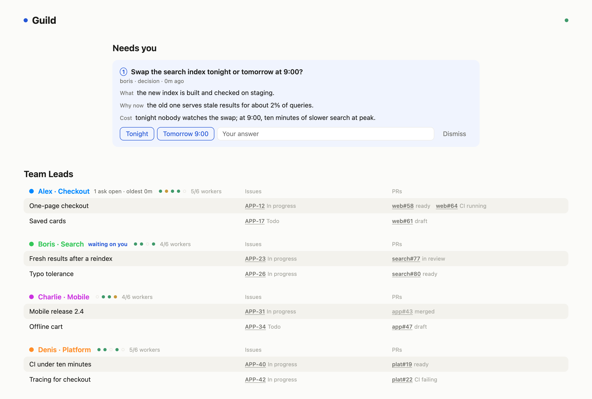
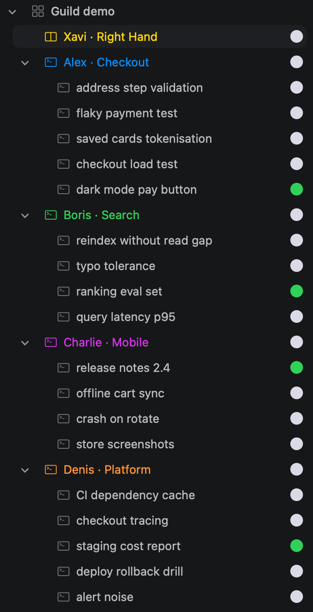
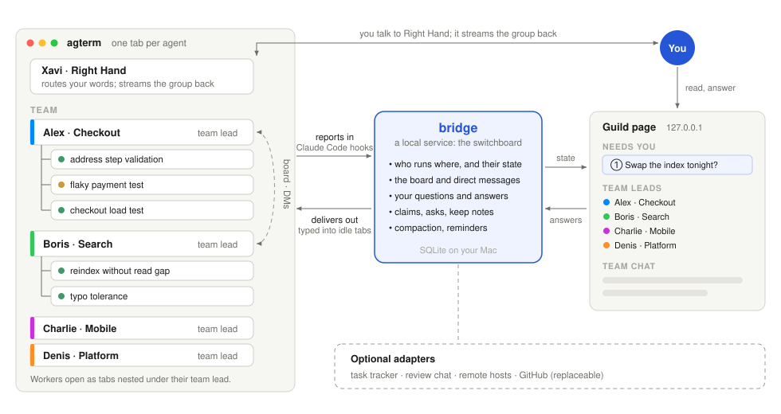
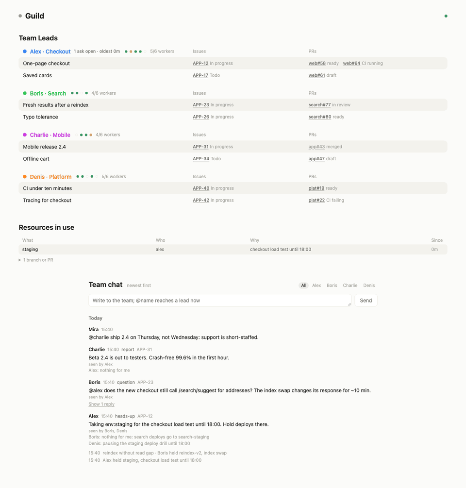
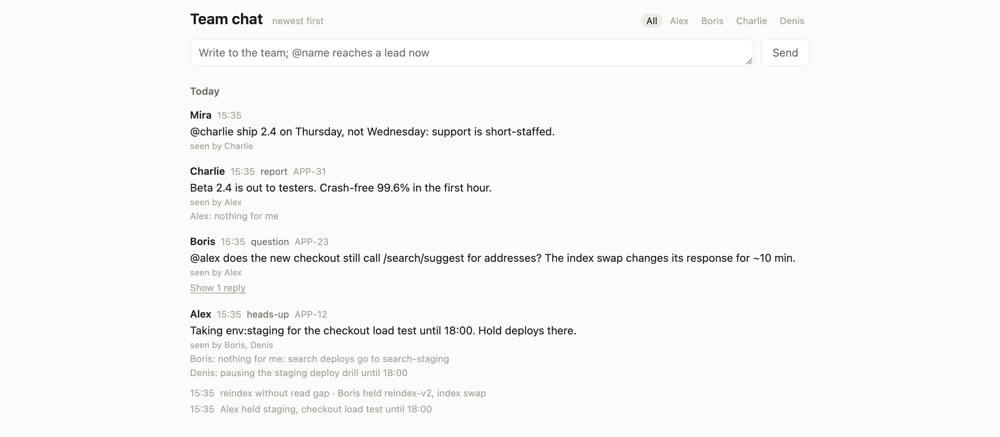
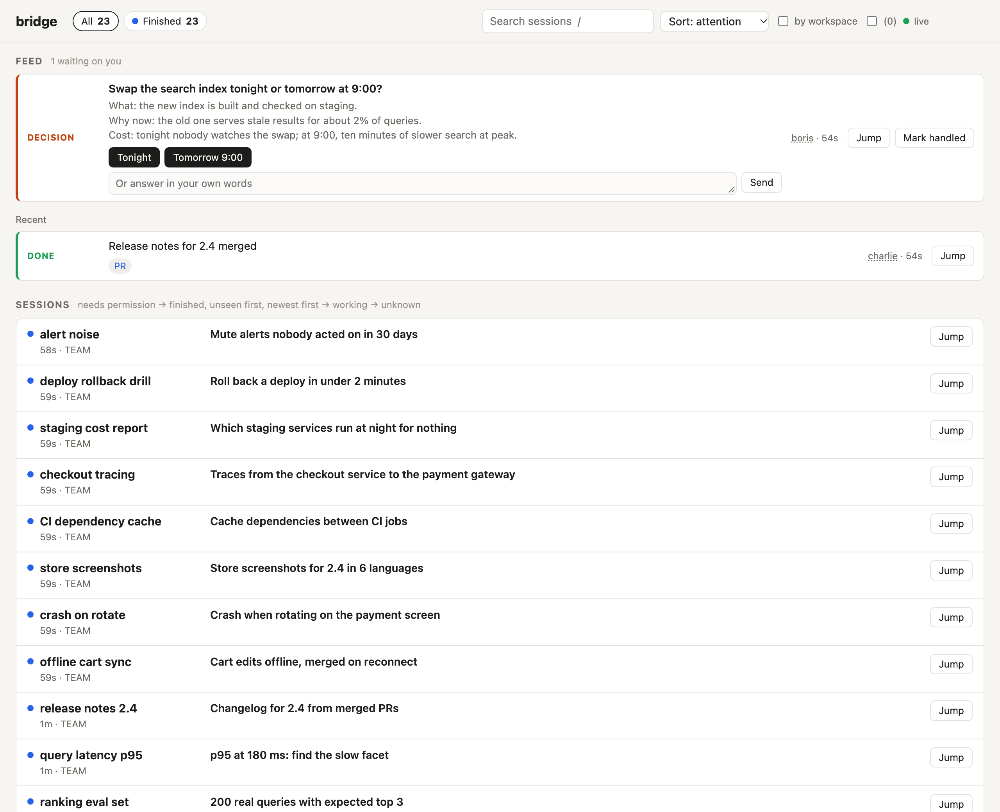

# Guild

**Lead a group of Claude Code team leads from one page.** Each team lead runs its own team of agent workers. You are
the engineering director.

<picture>
  <source media="(prefers-color-scheme: dark)" srcset="docs/images/guild-dark.png">
  
</picture>

<sub>Demo data. macOS only · needs [agterm](https://github.com/umputun/agterm) and
[Claude Code](https://github.com/anthropics/claude-code) · MIT</sub>

## Why

Running several agents is easy. Staying in charge of them while you switch context all day is the hard part. Guild
gives an engineering group's usual structure to agents in one terminal: team leads who own projects, workers under
them, and you at the top, with one page that shows what needs you.

You choose how much you are involved, per project and per decision: anything from full vibe coding, where team leads
plan, build, test and merge on their own, to explicit rules, checkpoints and review points where they stop and wait
for you. Go deep on one project when it needs you; let the rest run. Your conversation with Right Hand is never
blocked: questions for you queue up on the page while you keep talking.

**You type no commands.** You talk to Right Hand and to your team leads in plain words, and they run everything. The
commands in this README only show how it works.

## In 30 seconds

<table>
<tr>
<td width="26%" valign="top"></td>
<td valign="top"></td>
</tr>
<tr>
<td valign="top"><sub>The group in agterm: Right Hand, four team leads, their workers.</sub></td>
<td valign="top"><sub>How it fits together: bridge in the middle carries every report, message and answer.</sub></td>
</tr>
</table>

- **Team leads.** A team lead is what Claude Code was before Guild: one window doing the work. Now it does not stop
  for you at every step. It takes tasks, splits them across workers, tests, verifies and merges, and asks you only what
  it cannot decide. Each one owns a project and lives in its own named, tinted agterm tab.
- **Workers.** A team lead opens a worker tab for each separate task, nested under it, and checks its result.
- **Right Hand.** The one tab you talk to. It routes your words to the right team lead, and it streams back what is
  happening in every team: decisions made, work finished, problems found.
- **bridge** is the switchboard underneath: a small local service. Every agent reports its state to it through Claude
  Code hooks; every message, answer and reminder goes out through it, typed into the right agterm tab; it serves the
  page. Agents talk to each other through it on a board and in direct messages, with no relaying by you.
- **Compaction with keep notes.** When an agent's context fills up, it saves what must survive, bridge compacts it and
  gives the notes back, so a team lead keeps going for days.
- **Everything else is optional**: a task tracker, a review chat, remote hosts, the GitHub PR queue.

<details>
<summary><b>See it update</b>: a question arrives, you answer it, the team lead reports back (12 s)</summary>


</details>

## Get started

1. Install [agterm](https://github.com/umputun/agterm).
2. Open a tab in it and start Claude Code (`claude`).
3. Paste this:

   ```text
   Set up Guild for me from https://github.com/Yuvasee/guild: install it, then start my Right Hand and a first team lead.
   ```

Claude Code follows [SETUP.md](SETUP.md): it checks what you have, installs Guild, starts the dashboard, and opens
Right Hand and your first team lead in their own tabs. It asks you only what it cannot know: your name and what the
first team lead should own. From then on, talk to Right Hand.

## Concepts

<details>
<summary><b>Team leads</b>: one autonomous owner per project</summary>

**Why:** you cannot hold five projects in your head, and you should not have to start each one again every morning.
A team lead holds one project for you, for days, and only brings you what needs you.

**How:** a team lead is a Claude Code session with a name, a scope and notes that outlive its conversations. Each new
session in its tab starts with its role, its notes and the group's state. It declares its main chunks of work with
their issues and PRs, and the page shows exactly those. It coordinates more than it types: separate tasks go to
workers.
</details>

<details>
<summary><b>Workers</b>: one tab per task, under its team lead</summary>

**Why:** one session doing five things loses track of all of them. A worker does one thing in its own context, in
parallel, and the team lead stays free to coordinate and check.

**How:** a team lead opens a worker in a new agterm tab nested under its own, with a brief, and confirms it really
started. Workers report back over bridge. A team lead runs a bounded number of them (`worker_cap`, default 5) and
closes them when their job is done, keeping the line that resumes each.
</details>

<details>
<summary><b>Right Hand</b>: your one conversation, both ways</summary>

**Why:** talking to every team lead yourself is exactly the context switching Guild exists to remove.

**How:** you talk to Right Hand in its tab. It passes your words to the right team lead, relays your answers, brings
you one question at a time with a recommendation, and keeps the project priority that orders the page. It also
streams the group back to you: what each team decided, finished or got stuck on, and what it checked itself versus
what it took on a team lead's word.

Your chat with Right Hand is never blocked by a pending question: questions wait on the page under **Needs you**, and
when you answer one in chat instead, Right Hand relays it and the question closes.
</details>

<details>
<summary><b>The board and direct messages</b>: agents talk to each other (core, always on)</summary>

**Why:** most questions one team has, another team can answer. If every one of them goes through you, you are the
bottleneck.

**How:** the board is a shared channel for heads-ups, questions, reports and handoffs; direct messages go to one agent.
A message is typed into the recipient's tab once it is idle, or reaches it at its next tool call. Every team lead sees
board posts from other team leads and from you; only an `@name` wakes an idle one. Team leads acknowledge a post in one
line, shown faint and delivered to nobody. A thread pauses after four agent hops until you post in it. You read and
write all of it on the page as **Team chat**.


</details>

<details>
<summary><b>Needs you</b>: the only queue you must read</summary>

**Why:** your attention is the scarcest thing in the group. It should go to decisions only you can make, in the order
that matters, and a pending decision should never stop your conversation: you keep talking while questions queue up.

**How:** when a team lead cannot go on without you, it posts a question with what, why now and what each answer costs,
and answer buttons. The page shows these under **Needs you**. Click an answer, or answer Right Hand in chat and it
relays your words; either way the answer is typed straight into the asking tab and the question closes. The
page numbers the top three across questions and PRs: urgent questions, other questions oldest first, then PRs by
project priority. An urgent question also raises a macOS notification.
</details>

<details>
<summary><b>Focus</b>: one line per agent on what it is doing now</summary>

**Why:** a glance should tell you what every agent is on, without reading its tab.

**How:** each agent keeps a one-line focus; the page and the other agents read it, and bridge reminds an agent whose
focus is missing or stale.
</details>

<details>
<summary><b>Claims</b>: no two agents on the same branch or environment</summary>

**Why:** parallel agents collide: two pushes to one branch, a deploy during someone's load test.

**How:** before touching a PR, branch, environment, path or issue another agent may use, an agent claims it; a second
claimant is refused and told who holds it. A hook also refuses `git push`, PR merges and configured deploy commands
aimed at something another live agent holds. The page lists claims under **Resources in use**.
</details>

<details>
<summary><b>Asks</b>: what you asked for, until you can see it done</summary>

**Why:** "done" from an agent often means "I changed something". You want to know it works where you will look.

**How:** every request you give goes into a ledger in your own words and stays there until someone other than the
agent that did the work has checked what you would see, and recorded where and how. Stale asks and unchecked claims
nag their owner.
</details>

<details>
<summary><b>Compaction and keep notes</b>: long-running agents that do not forget</summary>

**Why:** a team lead that loses its decisions at every compaction cannot own a project for days.

**How:** with `compact_at_tokens` set, an agent near that context size is told to save what must survive: decisions,
exact ids, open promises, the next step. bridge then types `/compact` into its tab and, after compaction, gives the
notes back with an instruction to continue. Team leads also get their role, notes and last dream back.
</details>

<details>
<summary><b>Dreams</b>: each night, a team lead's day turns into memory</summary>

**Why:** notes keep facts; they do not keep what the day felt like: what nagged, what went wrong, what you cared about.

**How:** when you say good night, Right Hand starts the dreams: each team lead's day (conversation, messages, notes,
work) goes to `claude -p`, which writes a short dream that comes back beside the role at the next start, and proposes
up to seven durable rules with their sources. The rules go to Right Hand as proposals; nothing is adopted by itself.
Each run is capped at $5.
</details>

<details>
<summary><b>The PR review queue</b> (GitHub): every open PR, and what each waits on</summary>

**Why:** you review what matters and let the rest merge without you, under rules you set.

**How:** with `review_org` set, every open PR in that GitHub org is on the page, grouped: waiting for you, ready to
merge, published, drafts. Your comments on GitHub are typed into the tab that owns the PR. A team lead merges its own PR
when GitHub approves it, CI is green and none of your threads is open; bridge refuses the merge otherwise. Large PRs
come with a review document and two independent reviews before they reach you.
</details>

<details>
<summary><b>The sessions page</b>: every agent on the Mac</summary>

**Why:** not every session belongs to a team; you still want to see all of them.

**How:** `/dashboard` lists every session with its focus, branch and claims, next to your feed and the board.


</details>

## Adapters

Everything outside the Mac is optional and replaceable. [docs/adapters.md](docs/adapters.md) has each interface and a
guide for having your own coding agent write an adapter.

| Adapter | What it does | Default | Built in |
| --- | --- | --- | --- |
| Task tracker (`tracker`) | issue titles and states on the page | a local tasks file | `tasks`, `exec` (any executable), `linear`, `none` |
| Review chat (`chat`) | where Publish posts a PR for review | none | `file`, `webhook`, `slack`, `none` |
| Code host | PR state, PR claims, the merge guard, the review queue | GitHub, through a signed-in `gh` | GitHub; a guide for GitLab, Gitea or plain git |
| Remote hosts (`[[remotes]]`) | runs in tmux sessions on other machines | none | ssh + tmux |

Without an adapter, its column, chip or button is simply absent. The board and direct messages are not adapters: they
are core and always on.

## Why agterm

Guild needs a terminal that a program can read and drive. [agterm](https://github.com/umputun/agterm) is a native
macOS terminal built for coding agents, with a control CLI (`agtermctl`). Guild uses it to:

- know which agent runs in which tab, and whether a tab is busy, idle or waiting on a dialog;
- type a message, an answer or `/compact` into an idle tab without clobbering what you were typing there;
- give each team lead a named, tinted tab in a `TEAM` workspace, and open workers as tabs nested under their team lead;
- jump to the tab behind any row on the page, and show the page as an overlay over a tab.

Without agterm, sessions still register and appear on the dashboard, but nothing is typed into tabs: messages wait for
each session's next tool call, and the group features (team lead tabs, workers, automatic compaction) do not work.
Tested with agterm 0.39.

## Limits

- macOS only: launchd, macOS notifications and process inspection are assumed.
- Claude Code only for the agents: Guild reads its hooks and session files. Other agents are not supported.
- One Mac, one person. The dashboard listens on 127.0.0.1 with no login; anything that can reach that port can post.
- Agents act with your accounts: `gh`, your tracker, your chat. The guards are a safety net, not a sandbox.
- Agents also get every claude.ai connector of the account Claude Code is signed in with (a tracker, a chat, a
  drive); disconnect any you do not want them to use.
- State is a SQLite file in `~/.local/state/bridge`; nothing leaves the Mac except calls to the services you configure.
- Built for and used in one person's daily work. Expect rough edges; commands and config may change.

## Commands

<!-- commands:start -->
<details>
<summary><b>Every command</b>, for reference: Right Hand and the team leads run these, not you</summary>

Full usage and flags: [docs/commands.md](docs/commands.md), or `<command> --help`.

| Command | What it does |
| --- | --- |
| **`bridge` · This session** | |
| [`bridge sessions`](docs/commands.md#bridge-sessions) | list live sessions |
| [`bridge whoami`](docs/commands.md#bridge-whoami) | show this session's registry entry |
| [`bridge focus`](docs/commands.md#bridge-focus) | set what this session is working on |
| [`bridge keep`](docs/commands.md#bridge-keep) | save notes that bridge gives back to this session after compaction |
| [`bridge handle`](docs/commands.md#bridge-handle) | set this session's stable handle (survives restarts of the tab) |
| **`bridge` · Messages between sessions** | |
| [`bridge send`](docs/commands.md#bridge-send) | message other sessions by handle (comma-separated) |
| [`bridge reply`](docs/commands.md#bridge-reply) | reply to a message |
| [`bridge ack`](docs/commands.md#bridge-ack) | mark message(s): seen, working on it |
| [`bridge done`](docs/commands.md#bridge-done) | mark message(s): request handled |
| [`bridge decline`](docs/commands.md#bridge-decline) | mark message(s): will not do it |
| [`bridge cancel`](docs/commands.md#bridge-cancel) | withdraw a message you sent |
| [`bridge inbox`](docs/commands.md#bridge-inbox) | messages for this session |
| [`bridge show`](docs/commands.md#bridge-show) | a message with its thread |
| **`bridge` · Your feed and the team board** | |
| [`bridge post`](docs/commands.md#bridge-post) | a post in the user's feed: blocked, decision, done or insight; `post resolve N` withdraws yours |
| [`bridge tell-user`](docs/commands.md#bridge-tell-user) | one line for the user's feed (older form of post) |
| [`bridge board`](docs/commands.md#bridge-board) | the team board: post to everyone (no TEXT: read recent posts) |
| **`bridge` · Claims** | |
| [`bridge claim`](docs/commands.md#bridge-claim) | reserve a shared resource before mutating it |
| [`bridge renew`](docs/commands.md#bridge-renew) | extend a claim you hold |
| [`bridge release`](docs/commands.md#bridge-release) | give a claim back |
| [`bridge who`](docs/commands.md#bridge-who) | who holds a resource |
| [`bridge claims`](docs/commands.md#bridge-claims) | all claims, or yours with tokens |
| **`bridge` · Dashboard** | |
| [`bridge serve`](docs/commands.md#bridge-serve) | run the dashboard web server |
| [`bridge open`](docs/commands.md#bridge-open) | open the dashboard as an agterm overlay (or in the browser) |
| [`bridge install-service`](docs/commands.md#bridge-install-service) | run the dashboard permanently under launchd |
| [`bridge uninstall-service`](docs/commands.md#bridge-uninstall-service) | stop and remove the launchd dashboard service |
| [`bridge restart-service`](docs/commands.md#bridge-restart-service) | restart the dashboard service (after reinstalling bridge) |
| **`bridge` · Setup** | |
| [`bridge install-hooks`](docs/commands.md#bridge-install-hooks) | add bridge hooks to Claude Code settings |
| [`bridge uninstall-hooks`](docs/commands.md#bridge-uninstall-hooks) | remove bridge hooks from Claude Code settings |
| [`bridge hook-stats`](docs/commands.md#bridge-hook-stats) | hook latency percentiles |
| **`bridge` · Outside services** | |
| [`bridge enrich`](docs/commands.md#bridge-enrich) | refresh GitHub PR and tracker issue state for live sessions |
| [`bridge remote-sync`](docs/commands.md#bridge-remote-sync) | collect sessions from configured remote hosts now |
| **`guild` · Team leads** | |
| [`guild leads`](docs/commands.md#guild-leads) | list team leads |
| [`guild lead add`](docs/commands.md#guild-lead-add) | make a tab a team lead: name, tint, a place in the TEAM workspace |
| [`guild lead label`](docs/commands.md#guild-lead-label) | change a lead's project label and rename its tab |
| [`guild lead sync`](docs/commands.md#guild-lead-sync) | apply a lead's tab name, tint and place in TEAM again |
| [`guild lead retire`](docs/commands.md#guild-lead-retire) | undo enrollment; the tab goes back, the name is never reused |
| [`guild lead wake`](docs/commands.md#guild-lead-wake) | type a first prompt into a lead's idle tab, so its role arrives |
| **`guild` · Workers** | |
| [`guild worker close`](docs/commands.md#guild-worker-close) | close your own nested tab and keep what resumes it |
| [`guild worker closed`](docs/commands.md#guild-worker-closed) | closed workers, newest first, with the command that resumes each |
| **`guild` · What team leads show and keep** | |
| [`guild work set`](docs/commands.md#guild-work-set) | add a chunk, or update it by name; given refs replace its refs |
| [`guild work done`](docs/commands.md#guild-work-done) | a chunk ended; it leaves the page |
| [`guild work list`](docs/commands.md#guild-work-list) | the open chunks |
| [`guild notes`](docs/commands.md#guild-notes) | a lead's or the assistant's notes that outlive conversations |
| [`guild handover`](docs/commands.md#guild-handover) | hand your work to a lead, from stdin |
| [`guild ack`](docs/commands.md#guild-ack) | a lead's one line on a board post; shown faint, delivered to nobody |
| [`guild ack-cost`](docs/commands.md#guild-ack-cost) | what board posts reaching every lead cost; tokens are an estimate |
| **`guild` · Your asks** | |
| [`guild ask add`](docs/commands.md#guild-ask-add) | record an ask in the owner's own words |
| [`guild ask list`](docs/commands.md#guild-ask-list) | asks not closed, oldest first |
| [`guild ask show`](docs/commands.md#guild-ask-show) | one ask with its history |
| [`guild ask start`](docs/commands.md#guild-ask-start) | open → in_progress |
| [`guild ask note`](docs/commands.md#guild-ask-note) | news on an ask not done yet or not verified yet; it counts as an update |
| [`guild ask wait`](docs/commands.md#guild-ask-wait) | it cannot move: its reminders pause until its next start, note, done, verify or reopen, or until --until passes |
| [`guild ask done`](docs/commands.md#guild-ask-done) | claim it done; another session verifies |
| [`guild ask verify`](docs/commands.md#guild-ask-verify) | done_claimed → verified, with evidence of what the owner would see |
| [`guild ask close`](docs/commands.md#guild-ask-close) | verified → closed (the assistant only, relaying the owner) |
| [`guild ask reopen`](docs/commands.md#guild-ask-reopen) | back to open: the result is not what they asked for |
| **`guild` · Right Hand** | |
| [`guild answer`](docs/commands.md#guild-answer) | relay the user's answer to a post in the feed (the assistant only) |
| [`guild priority set`](docs/commands.md#guild-priority-set) | replace the list, first project first (the assistant only) |
| [`guild priority show`](docs/commands.md#guild-priority-show) | the list as the page ranks by it |
| [`guild urgent`](docs/commands.md#guild-urgent) | questions marked urgent, newest first, to audit against the criteria |
| **`guild` · PR review queue (GitHub)** | |
| [`guild review list`](docs/commands.md#guild-review-list) | what the queue shows |
| [`guild review sentence`](docs/commands.md#guild-review-sentence) | the short description of what a PR does, for its review post |
| [`guild review doc`](docs/commands.md#guild-review-doc) | register a large PR's HTML document; the page serves this copy |
| [`guild review published`](docs/commands.md#guild-review-published) | record a post made by hand, so it is never posted again |
| [`guild review repost`](docs/commands.md#guild-review-repost) | send again a post whose sender stopped (look in the channel first) or that a dry run only logged |
| **`guild` · Dreams** | |
| [`guild dream`](docs/commands.md#guild-dream) | the night's dreams, in parallel and detached; default: config dream_leads |

</details>
<!-- commands:end -->

## Manual install

<details>
<summary><b>Install by hand</b>, for reference: SETUP.md is what Claude Code follows</summary>

You need macOS, [agterm](https://github.com/umputun/agterm), [Claude Code](https://github.com/anthropics/claude-code),
Python 3.12+ and [uv](https://docs.astral.sh/uv/). A signed-in `gh` is needed only for anything about PRs.

```sh
git clone https://github.com/Yuvasee/guild ~/.local/share/guild
uv tool install ~/.local/share/guild    # puts bridge, bridge-hook and guild on your PATH
bridge install-hooks                    # adds bridge's hooks to ~/.claude/settings.json
mkdir -p ~/.claude/skills && cp -R ~/.local/share/guild/agent/skills/bridge ~/.claude/skills/
bridge install-service                  # the dashboard under launchd, on http://127.0.0.1:8780/
                                        # or run it in the foreground: bridge serve
```

Settings live in `~/.config/bridge/config.toml`; every key is optional:

```toml
owner_name = "Mira"           # how agents refer to you
assistant_handle = "xavi"     # the tab with this name becomes Right Hand (default "aide")
night_words = ["Good night"]  # what you say to start the night's dreams
compact_at_tokens = 150000    # save keep notes and compact at this context size; 0 (default) is off
worker_cap = 5                # workers per team lead
```

Then in agterm: open a tab named after `assistant_handle` and start `claude` there: that is Right Hand. Open a tab in a
project directory, start `claude`, and ask Right Hand to make it a team lead (`guild lead add`).
</details>

## License

[MIT](LICENSE)
